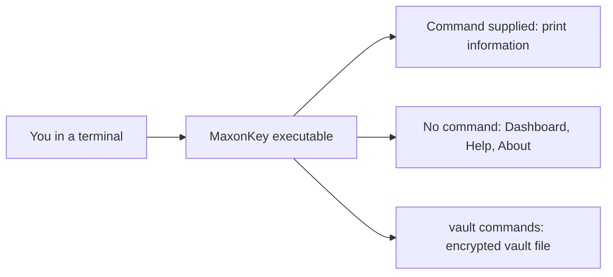

# MaxonKey 0.1.0

**A personal, local-first secrets manager being developed by Maxon Torres and published by Maxon Torres Software.**

> [!WARNING]
> **This version is a prototype, not a working secrets manager.**
> You can explore its interfaces and create an encrypted vault, but it cannot yet
> store, retrieve, or share secrets. Do not use it to manage passwords or credentials.

New here? Read [system requirements](#system-requirements), follow [installation](#installation)
for your operating system, then try the [quick start](#quick-start).

## Table of contents

- [What is MaxonKey?](#what-is-maxonkey)
- [Why MaxonKey?](#why-maxonkey)
- [Who is it for?](#who-is-it-for)
- [Features and availability](#features-and-availability)
- [How it works](#how-it-works)
- [System requirements](#system-requirements)
- [Installation](#installation)
  - [Precompiled downloads: not available yet](#precompiled-downloads-not-available-yet)
  - [Windows: install the tools and build](#windows-install-the-tools-and-build)
  - [Linux: install the tools and build](#linux-install-the-tools-and-build)
  - [macOS status](#macos-status)
- [Quick start](#quick-start)
- [CLI command reference](#cli-command-reference)
- [Terminal user interface](#terminal-user-interface)
- [Application structure](#application-structure)
- [Configuration and application data](#configuration-and-application-data)
- [Security](#security)
- [Development setup](#development-setup)
- [Building from source](#building-from-source)
- [Testing and quality checks](#testing-and-quality-checks)
- [Troubleshooting](#troubleshooting)
- [Frequently asked questions](#frequently-asked-questions)
- [Development roadmap](#development-roadmap)
- [Contributing](#contributing)
- [License](#license)

## What is MaxonKey?

MaxonKey aims to keep a developer's secrets organized on their own computer.
A **secret** is sensitive information such as a password, an API key used to access
an online service, or a database credential.

**Local-first** means the planned application will keep its primary data on your
computer and work without an internet connection. An **encrypted vault** is a
protected file whose contents can only be read with your **master passphrase**
(a long password only you know). Version 0.1.0 can create and manage that vault,
but it **cannot store secrets in it yet**.

Version 0.1.0 currently provides two ways to explore the application:

- A **command-line interface (CLI)**: type a command and read a short response.
- A **terminal user interface (TUI)**: use the keyboard to move between full-screen panels.

A **terminal** is a window where you type commands to run programs. MaxonKey does
not yet provide a separate desktop window, web application, or browser extension.

## Why MaxonKey?

Development credentials can become scattered across project folders, environment
files, and notes. MaxonKey's goal is a single, local place to organize them by
project and environment, with deliberate control over access.

An **environment** is a context such as development, testing, or production.
Future agent integration will require the owner's approval before sensitive
operations. These are product goals; the current prototype does not protect or
organize credentials.

## Who is it for?

- **Developers** interested in managing credentials for their own projects in the future.
- **People evaluating the interface** who want to try the navigation and provide feedback now.
- **Contributors** who want to improve a small Rust application with explicit security boundaries.

You do not need to know Rust to try the interface, but you currently need the build
tools described below. If you need a production password manager today, MaxonKey
0.1.0 does not meet that need.

## Features and availability

| Capability | Status | What this means today |
| --- | --- | --- |
| Help, version, About, and status commands | Implemented and verified | Run these commands without opening the full-screen interface. |
| Dashboard, Help, and About screens | Implemented and verified | Navigate with the keyboard and exit cleanly. |
| Millennium Blue theme and visible keyboard hints | Implemented and verified | Text labels and selection markers accompany color. |
| Small-terminal handling | Implemented and verified | The full layout needs 64 columns × 22 rows; smaller windows show resize guidance. |
| Secrets manager as a complete product | Partially implemented | The vault can be created and its passphrase managed. Secrets cannot be stored yet. |
| Encrypted vault creation (`vault init`) | Implemented (Task 002B) | Creates an encrypted vault file protected by your master passphrase and an optional recovery key. |
| Master-passphrase change and recovery | Implemented (Task 002B) | `vault change-passphrase` and `vault recover`. There is no reset without the passphrase or recovery key. |
| Encryption and SQLite vault storage | Implemented (Task 002B) | XChaCha20-Poly1305 encryption, Argon2id key derivation, and a bundled SQLite database file. |
| Secret creation, retrieval, updates, and deletion | Planned; not implemented (Task 002C) | Sometimes called CRUD; none of these operations is available. |
| Backup, verify, and restore | Planned; not implemented (Task 002C) | Until then, copy the vault file while MaxonKey is not running. |
| Project and environment organization | Planned; not implemented | There are no project or environment management commands. |
| Model Context Protocol (MCP) integration | Planned; not implemented | MCP lets coding tools interact with an application; no MCP server exists here. |
| MCP owner approval | Required for future implementation | Approval must precede plaintext reads, creation, updates, and deletion. |
| Secure sharing | Future work; not implemented | There are no sharing or multi-user operations. |
| Precompiled downloads and installers | Planned; unavailable | Build from source using the instructions below. |
| Production secret management | Unsupported in this version | No secrets can be stored yet, and the vault has not had an independent security review. |

Task 002B (vault lifecycle) is implemented. Storing secrets arrives with Task 002C.
See the [roadmap](#development-roadmap) for the next steps.

## How it works

1. Open a terminal and run the executable, the file containing the built application.
2. Add a command such as `status` to receive a text response, or omit the command to open the TUI.
3. Read the implementation status or move between Dashboard, Help, and About.
4. Press **q**, **Esc**, or **Ctrl+C** to leave the TUI and return to your terminal prompt.

The application makes no network requests. It writes one data file, the encrypted
vault, and only when you run `maxonkey vault init`. Other commands only read it.
Building it is a separate process that downloads development dependencies and creates
files under `target/`.



## System requirements

### Operating systems and software

| Platform | Current verification and setup |
| --- | --- |
| Windows, 64-bit x86_64 | Primary target. Builds and automated Rust tests pass on GitHub-hosted Windows runners. Use Windows Terminal with PowerShell for the instructions below. Desktop Windows versions have not been individually certified. |
| Linux, 64-bit x86_64 | Builds, Rust tests, and automated terminal interaction tests pass on Ubuntu CI. The installation recipe below uses Ubuntu/Debian package names. Other distributions need equivalent build tools and are not independently verified. |
| macOS | A later target. No verified macOS build or installation procedure is provided yet. |
| ARM and other processor architectures | Not verified by the current CI matrix. Do not assume an x86_64 executable works on them. |

To **build from source**, you need Git (downloads the project), Rust (compiles the
source code), Cargo (Rust's build tool, installed with Rust), and a native compiler/linker.
The linker combines compiled pieces into the final executable. Installation steps
for these tools are below. Python 3 is needed only for the optional Linux terminal tests.

To **run an already built compatible executable**, Rust, Cargo, and Git are not
needed. You do need an interactive terminal for the TUI. Setup and the first build
need internet access; running the prototype does not.

### Hardware and terminal requirements

> [!NOTE]
> The project has **no measured minimum CPU, RAM, or disk specification** yet.
> The development recommendations below are planning guidance, not benchmarked minimums.

| Resource | Running the prototype | Building and developing |
| --- | --- | --- |
| Processor | Use an x86_64 computer matching the verified targets above. | A modern processor with at least two cores is a practical starting point. |
| Memory (RAM) | No runtime minimum has been established. | 8 GB of system RAM is a comfortable recommendation; smaller systems may build more slowly. |
| Free disk space | Allow room for the executable. One verified Linux release build was approximately 1.5 MiB; Windows size and future versions may differ. | Start with at least 5 GB free for tools and build files. This is an estimate, not a guaranteed upper bound. Windows build tools may need substantially more; check their installer estimate. |
| Terminal size | At least **64 columns × 22 rows** for the full layout; **80 × 24 or larger** is recommended. | The same size is useful for manual TUI testing. |
| Display and input | Keyboard and a readable terminal font. A true-color terminal best reproduces the theme. | No special graphics card or GPU is required by the application. |

Memory use and storage needs will change when vault functionality is introduced.
No minimum-hardware compatibility claim is made for that future version.

## Installation

### Precompiled downloads: not available yet

A **precompiled executable** is an application someone has already built, so users
can run it without installing Rust. MaxonKey intends to distribute Windows and Linux
executables this way, with architecture-specific downloads and integrity checks.

**There are currently no published release downloads, installers, or supported
package-manager installation commands.** The repository is not published as a Cargo
package. Do not use an assumed `cargo install`, winget, apt, or Homebrew command to
install MaxonKey. The apt commands below install development tools, not MaxonKey.

For now, building from source is the available installation method. The instructions
below create a local executable; they do not create a vault or register a background service.

### Windows: install the tools and build

Use these instructions on an x86_64 Windows computer. The graphical installer steps
were not independently exercised in the Linux documentation environment; Windows CI
verifies the application's build and tests, not a fresh desktop installation.

1. **Install a terminal and Git.** Open **Start**, search for **Terminal**, and open
   a **PowerShell** tab. If Windows Terminal is absent, obtain it from the
   [official Windows Terminal installation guide](https://learn.microsoft.com/windows/terminal/install).
   Download Git from [Git for Windows](https://git-scm.com/download/win), run its
   installer, and keep command-line Git available to other applications.

2. **Install the native build tools.** Download
   [Microsoft C++ Build Tools](https://visualstudio.microsoft.com/visual-cpp-build-tools/).
   In Visual Studio Installer, select **Desktop development with C++**, including
   the MSVC compiler and a Windows SDK offered by the installer. Complete installation;
   restart Windows if the installer requests it. Installing the full Visual Studio
   editor is not required.

3. **Install Rust.** Visit [rustup.rs](https://rustup.rs/), download the Windows
   `rustup-init.exe` installer, and run it. Choose the default stable MSVC installation
   unless you already maintain a different Rust setup. Rustup manages Rust versions
   and installs Cargo. Close and reopen PowerShell afterward so it finds the new tools.

4. **Confirm that the tools work.** In PowerShell, run:

   ```powershell
   git --version
   rustup --version
   rustc --version
   cargo --version
   ```

   Each command should print a version instead of a “not recognized” error. Exact
   version numbers may change. If a command is missing, reopen the terminal and
   check that its installer finished; see [troubleshooting](#troubleshooting).

5. **Download the source and build it.** Start in your user folder, then run:

   ```powershell
   Set-Location $HOME
   git clone --branch main https://github.com/maxontorres/maxonkey.git
   Set-Location maxonkey
   cargo build --release --locked
   ```

   `git clone` creates a `maxonkey` folder containing the source. `--branch main`
   selects the current bootstrap branch. `Set-Location` changes folders. Cargo
   downloads the locked dependencies and builds an optimized executable. The first
   build can take several minutes. Success ends with `Finished` and a release-build
   message, without an error. If the folder already exists, use your existing clone
   or clone into a different empty folder; do not delete unrelated work.

6. **Run your executable.** From the project folder:

   ```powershell
   .\target\release\maxonkey.exe --version
   .\target\release\maxonkey.exe status
   ```

   The first command should print `maxonkey 0.1.0`; the second should list working
   interfaces and `NOT IMPLEMENTED` secret-management capabilities. The `.\` path
   prefix tells PowerShell to run a file relative to the current folder.

7. **Optionally keep a copy outside the source folder.** This is a manual copy of
   your local build, not a precompiled download or installer:

   ```powershell
   New-Item -ItemType Directory -Force "$HOME\bin"
   Copy-Item .\target\release\maxonkey.exe "$HOME\bin\maxonkey.exe"
   & "$HOME\bin\maxonkey.exe" --version
   ```

   The last command should again print `maxonkey 0.1.0`. `&` runs the quoted path.
   Using this full path avoids changing Windows PATH settings. If copying reports
   that the executable is in use, exit MaxonKey before replacing it. If a build
   reports `link.exe` missing, revisit step 2.

### Linux: install the tools and build

These package commands are for Ubuntu/Debian and use **Bash**. Open your desktop's
Terminal application, or use an existing terminal session. You need administrator
access for system packages, but build and run MaxonKey as your normal user.
The source build and manual-copy steps are tested on Linux. The system-package and
rustup installer steps have not been re-tested on a clean OS for this documentation update.

1. **Install development prerequisites.** Run:

   ```bash
   sudo apt update
   sudo apt install build-essential curl git
   ```

   `apt update` refreshes package information. The second command installs the native
   compiler/linker, a download tool, and Git. Enter your administrator password when
   prompted; it is normal for password characters not to appear. Success returns
   you to the prompt without an installation error. If `sudo` or `apt` is unavailable,
   this recipe does not match your setup; use your distribution's equivalent tools.

2. **Install Rust from its official installer.** Download and run the installer:

   ```bash
   curl --proto '=https' --tlsv1.2 -sSf https://sh.rustup.rs -o /tmp/maxonkey-rustup-init.sh
   sh /tmp/maxonkey-rustup-init.sh
   . "$HOME/.cargo/env"
   ```

   Choose the default installation when prompted. The last command loads Rust's
   tool paths into the current Bash session. You may review the downloaded shell
   script before running it. If downloading fails, check the network or proxy settings;
   do not disable TLS certificate verification. If Rust is already installed through
   rustup, confirm the tools in step 3 instead of reinstalling it.

3. **Confirm the tools and download the project.** Run:

   ```bash
   git --version
   rustup --version
   rustc --version
   cargo --version
   cd "$HOME"
   git clone --branch main https://github.com/maxontorres/maxonkey.git
   cd maxonkey
   ```

   The first four commands should print versions. The clone command creates the
   source folder, and `cd` enters it. If that folder already exists, use your existing
   checkout or choose a different empty destination rather than overwriting work.

4. **Build and verify the application.** Run:

   ```bash
   cargo build --release --locked
   ./target/release/maxonkey --version
   ./target/release/maxonkey status
   ```

   Cargo should finish the release build without errors. Expect `maxonkey 0.1.0`
   and the status text shown in [quick start](#quick-start). If the build says `cc`
   is missing, check that `build-essential` was installed successfully. The `./`
   prefix tells Bash to run a file relative to the current folder.

5. **Optionally copy the local build to your personal applications folder.** From
   the project root, run:

   ```bash
   mkdir -p "$HOME/.local/bin"
   install -m 755 target/release/maxonkey "$HOME/.local/bin/maxonkey"
   "$HOME/.local/bin/maxonkey" --version
   ```

   `mkdir` creates the directory if needed; `install` copies the executable and gives
   it executable permissions. The last command should print `maxonkey 0.1.0`. This
   copy can run without the source folder or Rust. Check [license](#license) before
   assuming redistribution rights.

6. **Optionally make the short command available in this session.** Run:

   ```bash
   export PATH="$HOME/.local/bin:$PATH"
   maxonkey --version
   ```

   PATH is the list of folders your shell searches for commands. The export above
   lasts for this session. For future Bash sessions, add the same export line once
   to your `~/.bashrc` file with a text editor, then open a new terminal. Full-path
   commands work without this change. If a permission error occurs, ensure the
   destination is owned by your user; do not run the application with `sudo`.

### macOS status

macOS is a planned target, but it is not in the current CI matrix and has no verified
installation recipe. The Windows and Linux procedures are not a macOS support claim.
If you experiment with a source build, please report the macOS version, architecture,
Rust version, and any errors. Do not use an experimental build for secrets.

## Quick start

First finish [installation](#installation). Open PowerShell on Windows or Bash on
Linux, and enter the cloned project folder. Pick the command block for your system;
these paths refer to the executable produced by the release build.

1. **Confirm the version and discover commands.**

   Windows:

   ```powershell
   .\target\release\maxonkey.exe --version
   .\target\release\maxonkey.exe --help
   ```

   Linux:

   ```bash
   ./target/release/maxonkey --version
   ./target/release/maxonkey --help
   ```

   Expect `maxonkey 0.1.0`, followed by help containing `version`, `about`, `status`,
   `vault`, and `help`. The help page also explains that running without a command opens the TUI.

2. **Inspect current capabilities.**

   Windows:

   ```powershell
   .\target\release\maxonkey.exe status
   ```

   Linux:

   ```bash
   ./target/release/maxonkey status
   ```

   Expected output:

   Expected output (your vault path will differ):

   ```text
   MaxonKey prototype
   CLI / TUI: IMPLEMENTED
   Vault init / passphrase / recovery: IMPLEMENTED
   Encryption / SQLite storage: IMPLEMENTED
   Secret CRUD: NOT IMPLEMENTED
   Projects / environments: NOT IMPLEMENTED
   Backup / restore: NOT IMPLEMENTED
   MCP server: NOT IMPLEMENTED
   MCP owner approval: NOT IMPLEMENTED
   Secure sharing: NOT IMPLEMENTED
   Vault: NOT INITIALIZED
   Vault path: /home/you/.local/share/maxonkey/vault.sqlite3
   Secrets cannot be stored yet.
   ```

   `NOT IMPLEMENTED` is the correct result for features that do not exist yet.

3. **Open the TUI.** Run the executable without an extra command:

   Windows:

   ```powershell
   .\target\release\maxonkey.exe
   ```

   Linux:

   ```bash
   ./target/release/maxonkey
   ```

   The Dashboard should fill the terminal. Press **2** for Help, **3** for About,
   and **1** to return to Dashboard. Press **q** to exit. Seeing all three screens
   and returning to a usable terminal completes your first successful run.
   If the window is too small, enlarge it to at least 64 columns × 22 rows.

4. **Optional: create your encrypted vault.** See [vault setup](#vault-setup).

## CLI command reference

The general syntax is `maxonkey [COMMAND]`. Brackets mean the command is optional;
do not type the brackets. A **flag**, such as `--help`, modifies a command's behavior.

The table uses `maxonkey` as shorthand. Unless you have placed it on PATH, replace
that word with `.\target\release\maxonkey.exe` in PowerShell or
`./target/release/maxonkey` in Bash.

| Command or syntax | Purpose | Expected result |
| --- | --- | --- |
| `maxonkey` | Open the full-screen interface. | Dashboard appears; an interactive terminal is required. |
| `maxonkey help` | List commands and flags. | Help text; successful exit. |
| `maxonkey --help` or `maxonkey -h` | Show the same top-level help. | Usage information; successful exit. |
| `maxonkey version` | Print the application version. | `maxonkey 0.1.0` |
| `maxonkey --version` or `maxonkey -V` | Print the version using a flag. | `maxonkey 0.1.0` |
| `maxonkey about` | Identify the application and publisher. | MaxonKey version, Maxon Torres Software, and prototype limitations. |
| `maxonkey status` | Report current implementation status and whether a vault exists. | Capabilities labeled; `Vault: NOT INITIALIZED` or `Vault: INITIALIZED (LOCKED)`. |
| `maxonkey vault init` | Create the encrypted vault. | Asks for a new passphrase twice, shows a recovery key once, then `Vault created: <path>`. |
| `maxonkey vault init --no-recovery-key` | Create the vault without a recovery key. | As above, plus a warning that a forgotten passphrase cannot be recovered. |
| `maxonkey vault status` | Show vault details without asking for the passphrase. | Path, format version, key-derivation settings, recovery key, permissions. |
| `maxonkey vault change-passphrase` | Replace the master passphrase. | Asks for the current passphrase, then the new one twice. |
| `maxonkey vault recover` | Set a new passphrase using the recovery key. | Asks for the recovery key, then the new passphrase twice. |
| `--vault <PATH>` | Use a different vault file with any command. | Useful for testing or a portable vault. |

Examples from the project root on Linux:

```bash
./target/release/maxonkey about
./target/release/maxonkey help
```

Examples from the project root on Windows:

```powershell
.\target\release\maxonkey.exe about
.\target\release\maxonkey.exe help
```

Informational commands print to the terminal and exit; they do not create data.
Only `vault init` creates a file. An **exit code** is the number other programs use to
tell whether a command succeeded:

| Exit code | Meaning |
| --- | --- |
| 0 | Success |
| 1 | General error, for example passphrases did not match or no terminal is available |
| 2 | Unknown command or option |
| 3 | Wrong passphrase or recovery key (or a damaged key slot) |
| 4 | Vault integrity failure: the file is damaged, modified, or not a MaxonKey vault |
| 5 | No vault exists yet |

There are no secret-management commands in this version.

### Vault setup

1. Run `maxonkey vault init` in a terminal (PowerShell, Windows Terminal, or Bash).
2. Type a **master passphrase** of at least 12 characters, then repeat it. Typing is
   hidden. Four or more random words, such as a phrase you will remember but nobody
   could guess, work well. MaxonKey cannot reset it for you.
3. MaxonKey shows a **recovery key**: 13 groups of four letters and digits. It appears
   once and is never saved to a file. Write it on paper or store it in a separate
   password manager, then press Enter. Anyone holding it can open your vault.
4. Clear your terminal scrollback (Windows Terminal: **Ctrl+Shift+K**; most Linux
   terminals: `clear` or the menu's "Clear scrollback") so the key does not stay on screen.
5. Run `maxonkey vault status` to confirm `Vault: INITIALIZED (LOCKED)`.

MaxonKey asks for passphrases only on the terminal itself. It never accepts them as
command options, environment variables, or piped input, so they do not end up in
shell history. Commands that need the passphrase fail with exit code 1 when no
interactive terminal is available, for example inside a script or an AI agent tool.
Each command unlocks the vault, does its work, and locks it again before exiting.
Unlocking takes about one second on purpose: it makes passphrase guessing slow.

## Terminal user interface

### Screens

| Screen | What you can do |
| --- | --- |
| Dashboard | See whether a vault exists (`NOT INITIALIZED` or `INITIALIZED (LOCKED)`) and which capabilities are implemented. It does not show secrets or audit activity, and it cannot unlock the vault. |
| Help | Read keyboard controls and available CLI commands. |
| About | Read the version, publisher, platform direction, and prototype limitations. |

### Keyboard controls

| Key | Action |
| --- | --- |
| Tab, Right Arrow, or Down Arrow | Move to the next screen, wrapping after About. |
| Shift+Tab, Left Arrow, or Up Arrow | Move to the previous screen, wrapping before Dashboard. |
| 1 | Open Dashboard. |
| 2 or ? | Open Help. |
| 3 | Open About. |
| q, Esc, or Ctrl+C | Exit and restore the terminal. |

Clicking and mouse navigation are not implemented. No text-entry field is present.
Navigation is immediate; you do not need to press Enter after selecting a screen.

### Theme and accessibility

The **Millennium Blue — Accessible Cyber Console** theme uses a dark background,
light text, electric and ice blue accents, violet decorative borders, and amber
warning markers. A selected screen has a `>` marker and a double border. Unavailable
features use `[!]` and explicit labels, so color is not the only way meaning is conveyed.
The exact palette is maintained in the [UI design document](docs/ui-design.md).

There are no animations. Reduced motion is therefore the current default; future
animations must remain optional. Below 64 × 22, the interface displays a resize
notice rather than the full screens. Navigation and exit keys still work. For a
readable result, enlarge the window or reduce its font size. The CLI information
commands remain useful when a full-screen interface is unsuitable.

Normal exit restores the previous terminal screen, cursor visibility, and input
mode. Force-killing a process, closing the terminal, or losing the terminal connection
cannot guarantee that cleanup runs. Recovery steps are in [troubleshooting](#troubleshooting).

## Application structure

The **repository** is the folder containing the source code, documentation, and tests.
Its root is the folder containing `Cargo.toml` and this README.

```text
maxonkey/
├── src/                    Application source
│   ├── main.rs             Starts the CLI or TUI and handles errors
│   ├── cli.rs              Defines commands and flags with clap
│   ├── commands.rs         Runs the vault commands
│   ├── crypto.rs           Encryption and key derivation (the only crypto code)
│   ├── info.rs             Shares truthful About and capability text
│   ├── paths.rs            Standard data folder and permission checks
│   ├── prompt.rs           Hidden terminal input
│   ├── secret.rs           Memory-wiping types for keys and passphrases
│   ├── store.rs            SQLite vault file access
│   ├── tui.rs              Screens, keyboard input, theme, and terminal cleanup
│   └── vault.rs            Vault create, unlock, passphrase change, recovery
├── tests/                  CLI, terminal, and commit-validator checks
├── docs/                   Product, security, UI, architecture, and decision records (adr/)
├── specs/                  Feature requirements, plans, tasks, and evidence
├── .github/                Automated checks, PR policy, Claude workflow, code owners
├── .githooks/              Optional local commit-message hook
├── .agents/skills/         Checked-in Spec Kit commands for Codex
├── .specify/               Spec Kit configuration, templates, and scripts
├── Cargo.toml              Package identity and direct dependencies
├── Cargo.lock              Exact resolved dependency versions
├── rust-toolchain.toml     Stable Rust with rustfmt and Clippy
├── AGENTS.md               Shared development and documentation rules
├── CLAUDE.md               Reference to the shared rules
├── deny.toml               Dependency advisory and license policy (cargo-deny)
└── target/                 Generated build files; appears after building
```

For implementation details, see the [architecture](docs/architecture.md).
For the accepted scopes, see the [Task 001 specification](specs/001-project-initialization/spec.md)
and the [encrypted vault specification](specs/002-encrypted-vault/spec.md).

## Configuration and application data

There are **no configuration files or environment-variable settings**. The theme and
shortcuts are fixed in the source. The only data MaxonKey stores is the encrypted
vault file, created by `maxonkey vault init` in your operating system's standard
per-user data folder, separate from the executable:

| Platform | Vault file |
| --- | --- |
| Windows | `%LOCALAPPDATA%\MaxonKey\data\vault.sqlite3` (not synchronized between computers) |
| Linux | `$XDG_DATA_HOME/maxonkey/vault.sqlite3`, falling back to `~/.local/share/maxonkey/vault.sqlite3` |
| macOS (not yet supported) | `~/Library/Application Support/MaxonKey/vault.sqlite3` |

Use `--vault <PATH>` to choose another file. On Linux the folder is created readable
only by you (`700`) and the file likewise (`600`); `vault status` warns if that changes.
On Windows the per-user folder is already private to your account; `vault status`
warns if the file grants access to broad groups such as Everyone or Users.

Current `target/` files are compiler output, not a vault. A manually copied executable
can run outside the repository. Copying it does not create or move the vault.

## Security

> [!IMPORTANT]
> MaxonKey 0.1.0 is not production-ready secret-management software.
> It can create an encrypted vault but cannot store secrets in it yet, and it has
> not had an independent security review.

What is implemented (Task 002B): the vault key is a random 256-bit key wrapped by a
key derived from your passphrase with Argon2id (256 MiB of memory, 3 passes), and by
the optional recovery key. Vault data is encrypted with XChaCha20-Poly1305. Changes to the
encrypted data or key settings are detected at unlock; replacing the whole file with
an older genuine copy is not. Passphrases are read only from the
terminal, keys are wiped from memory after use, and on Linux other programs running
as you cannot attach a debugger to MaxonKey or read its memory through `/proc`.

The application has no network requests, telemetry, clipboard access, or MCP server.
The vault is never "unlocked" between commands: each command locks it before exiting.

Planned protections include explicit owner approval before an MCP agent may read
plaintext, create, update, or delete a secret. Plaintext means readable, unencrypted
secret content. Approval enforcement is a future requirement, not a working safeguard
in this prototype. Never include real credentials in bug reports, test data,
screenshots, or documentation examples.

The security design is described by the approved [threat model](docs/security.md#threat-model),
the [key custody and storage decision record](docs/adr/0001-key-custody-and-storage.md),
and the [encrypted vault specification](specs/002-encrypted-vault/spec.md). Read
[what MaxonKey cannot protect against](docs/security.md#what-maxonkey-cannot-protect-against),
especially if you use AI coding agents on the same computer account.

## Development setup

This section is for people changing the project, rather than just trying it.

1. Complete your platform's [installation](#installation) steps and open the cloned
   project root in a terminal. A code editor is optional; any Rust-capable editor can help.
2. Read [AGENTS.md](AGENTS.md), [CLAUDE.md](CLAUDE.md), and the active feature's
   specification, plan, and tasks. Shared instructions apply to every coding agent.
3. Confirm the toolchain and enable the local commit-message hook:

   ```sh
   rustup show active-toolchain
   git config core.hooksPath .githooks
   ```

   These two commands work in PowerShell or Bash. Rustup should select `stable`;
   the toolchain file requests rustfmt and Clippy automatically. A toolchain is the
   compiler and related tools used to build the project. The hook setting is local
   to this checkout; it does not install the application or change other repositories.
   The hook requires `sh` and `awk`: use Git Bash on Windows for its shell tests.

4. Understand the build files before editing dependencies. `Cargo.toml` names direct
   dependencies; `Cargo.lock` records the exact selected versions. `--locked` tells
   Cargo to use that lockfile without changing it. Do not delete it to bypass a failure.
5. Use the accepted spec → plan → tasks → implementation → verification workflow.
   Keep changes small and update user-facing documentation with the code.

Official Spec Kit 1.2.1 Codex integration is checked in. A fresh local Codex session
can discover `$speckit-*` skills from `.agents/skills/`; the Spec Kit CLI is not
required to build or run MaxonKey. Setup history and official links are in
[dependency and tooling decisions](specs/001-project-initialization/research.md).
Do not reinitialize Spec Kit over existing files just to run the application.

### Automated feature workflow

The owner starts agent work from GitHub: an issue labeled `claude:implement` asks Claude
Code to implement it and open a pull request, CI and Codex review the result, and the
owner approves security-sensitive changes; routine changes merge automatically. Setup steps, the merge policy,
and how to read results are in [development automation](docs/automation.md).

## Building from source

If you followed installation, you already completed a release build. This section
explains the build modes for repeat development; it does not replace the prerequisite steps.
Run Cargo commands from the repository root.

1. **Build a development executable:**

   ```sh
   cargo build --locked
   ```

   This favors build speed and debugging. The executable is `target/debug/maxonkey`
   on Linux or `target\debug\maxonkey.exe` on Windows.

2. **Build the optimized executable used in this guide:**

   ```sh
   cargo build --release --locked
   ```

   `--release` selects the optimized build. The executable is `target/release/maxonkey`
   on Linux or `target\release\maxonkey.exe` on Windows. Successful builds end with
   `Finished`; a cached build may finish almost immediately.

3. **Optionally build and run in one step:**

   ```sh
   cargo run --locked -- --help
   cargo run --locked -- status
   cargo run --locked
   ```

   These commands work in PowerShell or Bash. Cargo uses the development build by
   default. The standalone `--` separates Cargo's options from arguments passed to
   MaxonKey. The last command opens the TUI; press q to return to the prompt.

The first build fetches third-party Rust packages, called dependencies. Later runs
can reuse downloaded packages and compiled files. Offline rebuilding is possible
only if all required tools and dependencies are already available; the application
itself works offline. No SQLite installation or external service is needed.

## Testing and quality checks

Run the following from the repository root in PowerShell or Bash. Each command must
finish successfully; a command that fails has not verified the project.

| Command | What it checks | Successful result |
| --- | --- | --- |
| `cargo fmt --all -- --check` | Formatting matches Rust's standard formatter. | No differences; often no output. |
| `cargo check --locked` | The source and types can be checked without producing a final executable. | `Finished`, without compiler errors. |
| `cargo clippy --locked --all-targets -- -D warnings` | Clippy, Rust's code-quality checker, finds no warnings in application/test targets. | `Finished`, with no warnings or errors. |
| `cargo test --locked` | Automated parsing, CLI output, navigation, layout, encryption, and vault tests pass. | At Task 002B completion: 39 unit tests and 9 CLI integration tests, all passing. Counts may grow. |
| `cargo build --release --locked` | The optimized executable can be built. | `Finished`, without build errors. |

Copyable sequence:

```sh
cargo fmt --all -- --check
cargo check --locked
cargo clippy --locked --all-targets -- -D warnings
cargo test --locked
cargo build --release --locked
```

Two additional checks cover repository policy and terminal cleanup:

1. **Commit-message validator tests.** Use Bash on Linux or **Git Bash** on Windows:

   ```sh
   sh tests/commit_msg.sh
   ```

   Expect `PASS: commit-message format acceptance tests`. This does not change Git history.

2. **Real terminal interaction tests on Linux only.** Install Python 3 if it is missing
   (`sudo apt install python3` on Ubuntu/Debian), then run in Bash:

   ```bash
   python3 --version
   python3 tests/tui_pty.py target/release/maxonkey
   ```

   Expect three `PASS` lines for q, Esc, and Ctrl+C. The script creates a
   pseudo-terminal, a test-controlled terminal connection, and checks screen/cursor/input
   restoration; its navigation scenario also resizes the terminal. It does not require
   a third-party Python package. It is not a Windows or macOS terminal test.

   The vault test drives real `vault` commands through a pseudo-terminal with test-only
   passphrases in a temporary folder (your real vault is not touched). It takes about
   30 seconds because it uses the real key-derivation cost:

   ```bash
   python3 tests/vault_pty.py target/release/maxonkey
   ```

   Expect `PASS` lines and one `INFO` line with the measured unlock time.

3. **Dependency advisories and licenses.** CI downloads a pinned, checksum-verified
   [cargo-deny](https://github.com/EmbarkStudios/cargo-deny) 0.20.2 and runs
   `cargo deny --locked check advisories licenses` using `deny.toml`. Locally, install it
   with `cargo install cargo-deny --version 0.20.2 --locked` and run the same command.

[GitHub Actions](https://github.com/maxontorres/maxonkey/actions) runs the Rust checks
and validator tests on Windows and Ubuntu, plus terminal, vault, and cargo-deny checks on Ubuntu,
for every pull request and every push to `main`. A separate **Repository policy** job checks
commit messages, scans the full Git history for accidentally committed credentials with a
pinned [gitleaks](https://github.com/gitleaks/gitleaks), and runs `python3 tests/spec_check.py`
(every specification has its spec, plan, and tasks files, and Markdown links resolve). A green
run applies to the commit it tested, not automatically to later changes. Local Linux
and Windows CI results do not substitute for manual Windows TUI testing.

## Troubleshooting

| Problem | What to do |
| --- | --- |
| `cargo`, `rustc`, or `git` is not found | Finish the matching tool installation, then close and reopen the terminal. On Bash after rustup installation, run `. "$HOME/.cargo/env"`. Confirm the version commands in installation. |
| PowerShell does not recognize `maxonkey` | Use `.\target\release\maxonkey.exe` from the project root, or the quoted full path with `&`. Building does not automatically add the program to PATH. |
| Bash says `maxonkey: command not found` | Use `./target/release/maxonkey` from the project root, or the full path to your installed copy. See the optional PATH step under Linux installation. |
| Cargo cannot find `Cargo.toml` | You are in the wrong folder. Enter the cloned `maxonkey` directory before building. |
| Git says the destination folder already exists | Inspect the existing folder. Use the existing clone if appropriate, or choose a different empty destination; do not delete unrelated files. |
| Windows build cannot find `link.exe` or a Windows SDK | In Visual Studio Installer, install/repair Desktop development with C++, MSVC tools, and a Windows SDK. Reopen the terminal afterward. |
| Linux build cannot find `cc` | Install the native build tools; on Ubuntu/Debian, use `sudo apt install build-essential`. |
| Dependency downloads fail | Check internet access, corporate proxy, and certificate configuration. Retry after fixing access. Do not disable TLS verification or change dependencies just to work around connectivity. |
| Cargo reports that the lockfile needs updating | Confirm you are using the intended checkout and its committed Cargo.lock. Investigate manifest/lockfile differences; do not delete the lockfile or drop `--locked` to hide the problem. |
| `clippy` or `rustfmt` is missing | From the repository root, run `rustup component add clippy rustfmt`, then retry the check. |
| The TUI says it requires an interactive terminal | Run it directly in a terminal without a pipe or output redirection. Some editor output panels are not terminals. Use `--help` or `status` for text-only output. |
| The TUI only shows resize guidance | Enlarge the window to at least 64 columns × 22 rows. Try a smaller readable font. |
| Colors or borders look different | Use Windows Terminal or a modern Linux terminal and a font with box-drawing characters. True-color support varies; rely on text labels and the `>` selection marker. |
| Keys seem unresponsive | Click the terminal to give it keyboard focus. Mouse clicks do not select screens. Try 1/2/3 or q; avoid holding keys down. |
| The terminal looks broken after forced termination | On Linux, try `stty sane` to restore input, then `reset` to redraw; you may need to type even if characters do not appear. These are system utilities, not MaxonKey commands. On Windows, close and reopen the terminal tab. Normal q/Esc/Ctrl+C exit should restore it automatically. |
| A copied Linux binary will not start | Confirm it matches the machine architecture and compatible system libraries, and has executable permission. A local source build is the verified path; arbitrary cross-distribution portability is not guaranteed. |
| The build runs out of memory or disk | Free disk space, close other large applications, and retry. `cargo build --release --locked -j 1` limits parallel compilation at the cost of speed. The hardware recommendations are not measured minimums. |
| Status says `NOT IMPLEMENTED` | This is expected for features that do not exist yet, such as storing secrets. |
| `cannot use the terminal … reads passphrases only from an interactive terminal` | Run the command directly in a terminal window. Scripts, pipes, editor output panels, and AI agent tools cannot supply a passphrase, by design. |
| Exit code 3: `wrong passphrase or recovery key` | Check Caps Lock and keyboard layout, then retry. If you have forgotten it, use `maxonkey vault recover` with your recovery key. |
| Exit code 4: `vault integrity check failed` | The vault file was damaged or modified. Do not delete it. Restore a copy you made earlier; built-in backup arrives in Task 002C. |
| Exit code 5: `no vault at …` | Create one with `maxonkey vault init`, or pass the right file with `--vault <PATH>`. |
| `a vault already exists` | `vault init` never overwrites a vault. Use the existing one, or pass a different `--vault <PATH>`. |
| `vault status` shows a permissions warning | Linux: run the `chmod` command it prints. Windows: in the file's Properties → Security, remove Everyone, Users, or Authenticated Users. |
| Forgotten passphrase and no recovery key | The vault cannot be opened. There is no back door; this is what keeps a stolen copy safe. |
| The commit hook rejects a message | Use exactly one line such as `Docs: Clarify Linux setup`, with an approved case-sensitive type and no body, footer, or attribution trailer. See AGENTS.md. |

If the problem persists, open an issue in the [repository issue tracker](https://github.com/maxontorres/maxonkey/issues).
Include your OS, processor architecture, `rustc --version`, the exact command, and the
error output. Remove credentials, tokens, and unrelated private information first.

## Frequently asked questions

### Can I save passwords or API keys now?

Not yet. You can create the encrypted vault and manage its passphrase, but adding,
reading, and deleting secrets arrives with Task 002C.

### Why must I install Rust if I am not a developer?

There are no downloadable executables yet. Rust builds the application from its
source code. Once a compatible executable has been built, running that file does not
require Rust. Future precompiled distribution is intended to remove this setup burden.

### Is the TUI a separate program from the CLI?

No. They are two ways of using the same `maxonkey` executable. A command prints
information; no command opens the full-screen interface.

### Does it need internet access or an account?

The current application needs neither. Downloading the project, installing tools,
and fetching build dependencies require network access. No cloud account or MaxonKey
registration is implemented.

### Where are my settings and vault?

There are no settings files. The vault is created by `maxonkey vault init` in your
standard data folder; see [configuration and application data](#configuration-and-application-data).
`maxonkey vault status` prints its exact path.

### Do I need administrator permissions to run it?

No. Administrator permissions may be needed to install system build tools, but the
prototype should be built and run as a normal user. A personal executable copy needs
no system-wide installation.

### Can a coding agent access my credentials through MaxonKey?

No. There is no MCP server, and the vault cannot hold secrets yet. Future integration
must enforce owner approval for plaintext reads, creation, updates, and deletion.

An AI agent running under your computer account can run `maxonkey` like you can, but it
cannot answer the passphrase prompt without knowing your passphrase. Never type your
passphrase into an AI chat. For stronger separation, run agents under a separate
operating-system account, container, or virtual machine; see the
[security model](docs/security.md#ai-agents-running-as-the-owner).

### How do I remove a local installation?

Exit MaxonKey, then remove the executable copy you created in your personal `bin`
folder. If you added a PATH entry only for this application, you may remove that
entry too. Removing the executable does not remove your vault; see
[configuration and application data](#configuration-and-application-data) for its
location, and delete it only if you are sure you no longer need it. Removing a clone
also removes that clone's source and build files, so preserve any work you want to keep.

## Development roadmap

| Milestone | Status and boundary |
| --- | --- |
| Task 001 — Foundation | Complete: Rust binary, CLI, Millennium Blue TUI, specifications, tests, and Windows/Linux CI. |
| Task 001B — Documentation | This update: comprehensive beginner guide and permanent documentation standards. Application behavior is unchanged. |
| Task 002A — Vault security architecture | Complete: threat model, ADR, and specification; all decisions approved by the owner. |
| Task 002B — Vault lifecycle | Complete: encryption core, `vault init/status/change-passphrase/recover`, tests, and cargo-deny in CI. |
| Task 002C — Secrets, backup, restore | Next: secret commands, record integrity manifest, key rotation, backup/verify/restore. |
| Later — Organization and secret operations | Planned work requiring its own specifications and verification. |
| Later — MCP integration | No server yet. Owner-approval boundaries must be designed and enforced before agent credential access. |
| Later — Sharing and distribution | Secure sharing, precompiled downloads, installers, and broader platform verification require separate work. |

No release dates or production-security guarantees are promised by this roadmap.
Task 002's approved security decisions are recorded in [Spec 002](specs/002-encrypted-vault/spec.md#owner-approval-checkpoint).

## Contributing

1. Read the [confirmed product requirements](docs/product.md), [security boundaries](docs/security.md),
   and [shared development rules](AGENTS.md). Start with an issue describing the problem or improvement.
2. Prepare the [development environment](#development-setup). Follow the repository's
   branch/review policy for the current task. Direct commits to `main` during this
   initial bootstrap phase are owner-authorized exceptions, not general contributor permission.
3. Write or update the relevant specification and acceptance criteria before changing
   application behavior. Documentation-only work must remain consistent with the source.
4. Implement a small, focused change, update the beginner documentation, and run the
   [quality checks](#testing-and-quality-checks). Verify examples and links for documentation changes.
5. Review the diff for accidental secrets and unnecessary attribution. Preserve legitimate
   contributor identities, dependency licenses, and required notices.
6. Use a single-line commit message: `Type: Short description`. Approved types are
   `Feature`, `Fix`, `Bug` (when explicitly requested), `Chore`, `Refactor`, `Test`,
   `Docs`, `Build`, and `Security`. No body, footer, co-author trailer, or AI self-attribution
   belongs in the message. The full policy and hook instructions live in AGENTS.md.

Do not upgrade dependencies without a reason and matching-version API review. Changes
to cryptography, key handling, or storage format require an updated specification and
decision record first. No contribution should implement MCP before its specification
is approved. Keep the project identity as MaxonKey, developed by Maxon Torres
and published by Maxon Torres Software.

## License

No project-level license file is currently present in this repository. Do not assume
that public source availability grants a particular open-source license. The project
needs an explicit license before its licensing terms can be stated here.

Third-party dependencies and bundled tools retain their own applicable licenses and
required notices. This documentation change does not alter those terms or notices.
